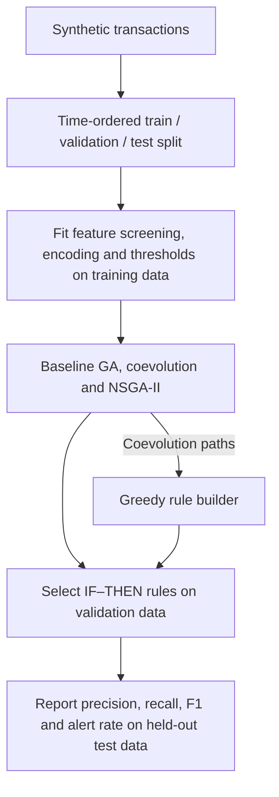

# Evolutionary Algorithms for Fraud Rule Optimization

**TransUnion × University of Illinois Chicago | MSBA Capstone**

> Can evolutionary algorithms discover interpretable fraud detection rules while balancing fraud capture against the operational cost of investigating alerts?

Fraud screening has two costs. False alerts take time away from investigators, while overly restrictive rules can let suspicious transactions pass. Our capstone studied whether evolutionary algorithms could discover readable IF–THEN rules and give fraud risk teams measurable choices about how many transactions to flag and how much fraud to capture.

  

## About This Repository

This is Anand Mathur’s portfolio presentation of work developed within the collaborative UIC MSBA TransUnion capstone. It preserves the earlier experiments, development notebooks, and technical documentation that show how the team explored single rules, rule sets, and the stability of the search. The finalized collaborative pipeline and its synthetic-data evaluation are maintained separately.

**[View the Finalized Team Project](https://github.com/dsany94/transunion-fraud-rule-optimization)**

## Why This Project Matters

Manual review capacity is finite. **Precision** tells a risk team what share of its alerts identify fraud. **Recall** tells it what share of all fraud it catches. **Alert rate** measures the share of all transactions sent to review, and **F1** summarizes precision and recall. Readable rules let analysts see which conditions caused an alert and evaluate whether those conditions make business sense.

Multi-objective optimization searches for several viable precision–recall trade-offs. That gives analysts operating points to compare against staffing limits, transaction volumes, and the cost of missed fraud. The capstone evaluated this approach offline as decision-support research for fraud rule discovery.

## How the Rules Were Discovered

The baseline genetic algorithm (GA) evolves one rule path. Cooperative coevolution evolves individual paths alongside complete rule sets, exchanging promising paths between the two populations. Mutation can change thresholds, operators, or conditions, and crossover swaps conditions or entire paths. A transaction is flagged **IF** every condition within a path holds (**AND**) and any one path matches across the set (**OR**).

The earlier combined notebook uses anonymized Kaggle credit card transactions, a stratified 70/15/15 split, training-only feature screening and binning, and validation-driven search. It compares the baseline and coevolution methods and checks the stability of selected rules across seeds. The final team pipeline uses synthetic transactions in simulated time order, encodes categorical features, bins a device-risk score, and screens candidate features on the training split. It adds **NSGA-II**, which searches for rules across competing precision and recall objectives, and a **greedy rule builder**, which assembles previously discovered paths based on incremental fraud coverage, false alerts, and rule complexity.

Conceptual architecture of the final team pipeline

[Experimental design, implementation details, and an original convergence plot](docs/portfolio/study-notes.md)

## Final Collaborative Study — Key Findings

The team evaluated **195 configurations across four methods** on synthetic transactions with a **70% training / 15% validation / 15% held-out test split** ordered by simulated time. The table reports the six selections in the team’s results summary, rounded for display. The earlier Kaggle experiments used a different dataset and split, so these results describe the final study in its own experimental setting. [Final study README](https://github.com/dsany94/transunion-fraud-rule-optimization/blob/9f7cf204a0d31370deb9a339275b27b9d6539812/README.md) · [Reported test metrics (JSON)](https://github.com/dsany94/transunion-fraud-rule-optimization/blob/9f7cf204a0d31370deb9a339275b27b9d6539812/results/results_summary.json)

| Method or operating point | Alert rate | Precision | Recall | F1 |
| --- | ---: | ---: | ---: | ---: |
| Baseline GA | 0.27% | 63.4% | 34.2% | 44.4% |
| Coevolution GA | 0.40% | 77.2% | 61.0% | 68.1% |
| NSGA-II · Conservative | 0.05% | 83.3% | 8.8% | 15.9% |
| NSGA-II · Balanced | 0.15% | 92.6% | 27.6% | 42.6% |
| NSGA-II · Aggressive | 0.90% | 39.4% | 69.7% | 50.3% |
| Greedy rule builder | 0.46% | 71.7% | 64.5% | 67.9% |

### What the trade-offs mean for investigations

At the reported test rates, per 10,000 transactions, the **conservative** point translates to roughly **5 alerts** while catching **8.8%** of fraud. The **balanced** point translates to roughly **15 alerts**, catches **27.6%**, and has the highest precision of the three. The **aggressive** point translates to roughly **90 alerts** and catches **69.7%**, with about four in ten alerts corresponding to fraud. A risk team could compare those workloads with its review capacity, weigh the cost of missed fraud, and inspect the rules that generate each alert. Which point fits depends on those constraints.

## Explore the Work

- [Baseline GA notebook](IDS560_GA_Algo.ipynb) evolves a single fraud rule and evaluates it on the credit card data.
- [Cooperative coevolution notebook](IDS560_Coevolution_GA.ipynb) demonstrates how path and rule-set populations exchange candidate rules.
- [Combined GA pipeline](IDS560_Combined_GA_Pipeline_v1_0.ipynb) compares both methods and includes validation-based operating-point selection and multi-seed stability analysis.
- [Coevolution further analysis](Coevolution_further_analysis.ipynb) records a sensitivity experiment with and without time features. Some supporting modules and prepared inputs are outside this checkout. [Analysis notes](README_COEVOLUTION_FURTHER_ANALYSIS.md)
- [Technical documentation](IDS560_Coevolution_GA_Documentation.md) details rule encoding, fitness, mutation, crossover, and population exchange.
- [Streamlit prototype](streamlit_GA_creditcard_app.py) provides a local interface for exploring baseline GA settings and evaluation outputs.

## Team and Sponsorship

**UIC MSBA · IDS 560 · Group 1.** Debangana Sanyal, Adrian Garces, Sam Chyu, Anand Mathur, and Siddhi Jain collaborated on the capstone with sponsorship from TransUnion. The research and finalized deliverable are credited to the team.
