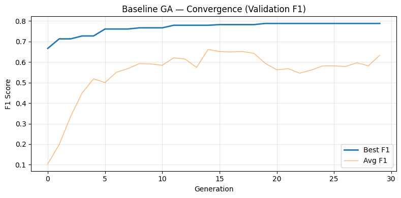

# Study Notes

[Back to the portfolio README](../../README.md)

## Earlier experiments in this repository

The [combined development notebook](../../IDS560_Combined_GA_Pipeline_v1_0.ipynb) uses the anonymized [Kaggle Credit Card Fraud Detection dataset](https://www.kaggle.com/datasets/mlg-ulb/creditcardfraud). Its saved run uses a stratified 70/15/15 split, excludes the raw time feature group, and reports 42,559 test records with 71 labeled frauds. The notebook fits feature bins and candidate thresholds on training data. It ranks features using mutual information with fraud-rate spread as a tiebreaker and retains the engineered V10 decile feature.

In that saved run, the single-rule GA obtained 84.48% precision and 69.01% recall on the test set. The coevolution rule set obtained 80.33% precision and 69.01% recall. Its balanced and aggressive selections coincided, and no validation candidate qualified for the conservative alert-rate limit. These are results of the earlier Kaggle experiment.

*Original saved output from Section 6 of the combined development notebook. This is validation F1 by generation for the earlier Kaggle baseline GA.*

The combined notebook varies the random seed to study search stability. The [further-analysis notebook](../../Coevolution_further_analysis.ipynb) also documents a five-seed comparison with and without time features, including rule overlap and metric variation. Its saved outputs can be inspected in the notebook. Replay depends on supporting modules and prepared inputs outside this checkout. The [logistic regression notebook](../../log_model.ipynb) is a separate development experiment on the Kaggle data. The repository’s tracked CSV is a Git LFS pointer, and the object was unavailable during the audit. The combined notebook accepts an uploaded copy of the Kaggle dataset.

## Final collaborative study

The final pipeline orders records by a simulated timestamp, keeps the last 15% for held-out evaluation, and drops the raw timestamp from the rule search. Training data determines categorical encodings, device-risk decile bins, screened features, and candidate thresholds. Validation data guides evolutionary search and operating-point selection. Coevolution scores rule sets for F1, coverage diversity, and simplicity while evolving paths and rule sets in separate, exchanging populations. NSGA-II keeps candidate rule sets across different precision–recall trade-offs. The greedy builder adds paths from coevolution’s saved candidates according to newly covered fraud, incremental false alerts, and a complexity penalty. [Final pipeline notebook](https://github.com/dsany94/transunion-fraud-rule-optimization/blob/9f7cf204a0d31370deb9a339275b27b9d6539812/notebooks/ga_fraud_rule_discovery_pipeline.ipynb)

The notebook documents baseline crossover, mutation and selection sweeps, coevolution coverage and complexity sweeps, NSGA-II population and crossover sweeps, and greedy-builder penalty sweeps. It also records coevolution stability runs across five seeds. The results CSV contains 195 configurations across the four methods. The team’s JSON names the specific runs and operating points summarized in the portfolio README. The team’s Streamlit app reads the exported results and lets users explore metrics, trade-offs, and rules locally. [Configuration results (CSV)](https://github.com/dsany94/transunion-fraud-rule-optimization/blob/9f7cf204a0d31370deb9a339275b27b9d6539812/results/all_model_results.csv) · [Summary (JSON)](https://github.com/dsany94/transunion-fraud-rule-optimization/blob/9f7cf204a0d31370deb9a339275b27b9d6539812/results/results_summary.json) · [Team Streamlit explorer](https://github.com/dsany94/transunion-fraud-rule-optimization/blob/9f7cf204a0d31370deb9a339275b27b9d6539812/streamlit_app/interactive_app.py)

The committed synthetic CSV contains 1,999 sample records, while saved evaluation outputs for the reported study show a 45,000-record test split. The final README and the overview in the job task analysis cite approximately 330,000 records. The detailed data section in the job task analysis describes 300,000, consistent with a 45,000-record test split at 15%. The portfolio README uses the documented split proportions and reported test metrics. The earlier Kaggle and final synthetic studies use different features, datasets, and evaluation configurations. Each study’s metrics should be interpreted within its own design. [Final study README](https://github.com/dsany94/transunion-fraud-rule-optimization/blob/9f7cf204a0d31370deb9a339275b27b9d6539812/README.md) · [Final pipeline notebook](https://github.com/dsany94/transunion-fraud-rule-optimization/blob/9f7cf204a0d31370deb9a339275b27b9d6539812/notebooks/ga_fraud_rule_discovery_pipeline.ipynb)

## Attribution sources

Both repository READMEs and the team’s job task analysis list the same five students and identify TransUnion as sponsor. Paul Williams is named consistently. The earlier README and the team document’s cover use **Jonah Henry**. The final README and the stakeholder list inside the team document use **Henry Jonah**. The portfolio credits TransUnion at the organizational level pending confirmation of the preferred spelling. The team’s materials credit the work collectively. A future individual contribution note could identify specific experiments, analysis, or deliverables Anand owned, with links to the corresponding artifacts.
